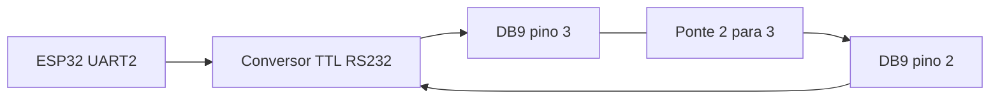

# ESP32 + RS232 — teste de loopback sem nobreak

Guia e programa de teste para validar a comunicação serial entre um **ESP32** e um **conversor TTL/RS232** antes de conectá-los a um nobreak.

> O teste confirma a UART2 do ESP32, a ligação dos jumpers, o conversor e os dois sentidos da comunicação. Ele **não confirma** a velocidade, o protocolo ou os comandos usados pelo nobreak.

## Resultado esperado

Com a ponte de loopback instalada, o Monitor Serial deve mostrar uma mensagem enviada, a mesma mensagem recebida e a confirmação de sucesso:

```text
Enviado: TESTE_RS232_1
Recebido: TESTE_RS232_1
SUCESSO: a comunicação ESP32 ↔ conversor RS232 está funcionando.
```

## Componentes

| Componente | Função |
| --- | --- |
| ESP32 DevKit | Executa o teste pela UART2. |
| Conversor TTL/RS232 | Adapta os sinais lógicos de 3,3 V do ESP32 ao padrão RS232. |
| Jumpers | Fazem as ligações entre ESP32 e conversor. |
| Ponte de loopback | Une os pinos 2 e 3 do conector DB9. |
| Cabo USB e computador | Alimentam/programam o ESP32 e exibem o Monitor Serial. |

## Antes de ligar: segurança elétrica

- **Nunca** conecte os GPIOs do ESP32 diretamente a uma porta RS232/DB9.
- Confira o CI do módulo. Se for um **MAX3232** — ou outro conversor indicado para 3,3 V — o VCC pode ser ligado ao pino `3V3` do ESP32.
- Se o módulo precisar de 5 V e fornecer 5 V no seu pino TTL `TXD`, ele **não pode** ser ligado diretamente ao `RX2` do ESP32: os GPIOs do ESP32 não são tolerantes a 5 V.
- Faça ou altere a ponte do DB9 com o conjunto desligado.

## Ligações do lado TTL

A ligação é cruzada: quem transmite deve ser ligado a quem recebe.

| ESP32 | Função | Módulo TTL/RS232 | Motivo |
| --- | --- | --- | --- |
| `GPIO17` / `TX2` | transmite | `RXD` | O conversor recebe a mensagem do ESP32. |
| `GPIO16` / `RX2` | recebe | `TXD` | O ESP32 recebe a mensagem devolvida pelo conversor. |
| `GND` | referência comum | `GND` | Garante a mesma referência elétrica. |
| `3V3` | alimentação | `VCC` | Use somente se o módulo for compatível com 3,3 V. |

Em algumas placas, `GPIO17` aparece como `D17` e `GPIO16` como `D16`. No código, use os números GPIO: `17` e `16`.



## Ponte de loopback no DB9

Com o circuito desligado, una os pinos **2** e **3** do DB9 do módulo:

| Pino DB9 | Sinal usual | Papel no teste |
| --- | --- | --- |
| `2` | RXD | Recebe de volta a mensagem enviada pelo pino 3. |
| `3` | TXD | Envia a mensagem para a ponte. |
| `5` | GND | Não deve ser unido aos pinos 2 e 3. |

Use os números gravados no próprio conector DB9. **Não use os pontos `C1`, `C2` ou similares da placa**, pois eles pertencem ao circuito do conversor e não são a ponte de loopback.

Se o módulo tem DB9 fêmea, use um plug DB9 macho de loopback ou tenha acesso físico aos terminais equivalentes aos pinos 2 e 3.

## Configuração do PlatformIO

No arquivo `platformio.ini`, use ou acrescente:

```ini
[env:esp32dev]
platform = espressif32
board = esp32dev
framework = arduino
monitor_speed = 115200
```

`monitor_speed` é a velocidade entre o computador e o ESP32 pelo USB. A comunicação com o conversor RS232 é configurada no código por `BAUD_RS232`.

## Como executar

1. Desconecte o cabo USB antes de mudar fios ou alimentação.
2. Faça as ligações TTL da tabela acima.
3. Instale a ponte entre os pinos 2 e 3 do DB9.
4. Conecte o ESP32 ao computador pelo USB.
5. Grave o programa e abra o Monitor Serial em **115200 bps**.
6. Confira se a mensagem recebida é igual à enviada.

No PlatformIO, você também pode usar os comandos:

```bash
pio run --target upload
pio device monitor --baud 115200
```

## Diagnóstico rápido

| Monitor Serial | Significado | O que verificar |
| --- | --- | --- |
| `Enviado` + `Recebido` + `SUCESSO` | O caminho de ida e volta está funcionando. | O teste foi concluído. |
| `FALHA: nenhuma mensagem recebida` | A mensagem não retornou para a UART2. | Ponte 2–3, fios cruzados, GND comum e VCC adequado. |
| Caracteres ilegíveis | As configurações seriais não coincidem. | `BAUD_RS232`, paridade, bits de dados e bits de parada. |
| Nenhuma mensagem no monitor | A porta USB/serial não está configurada ou aberta corretamente. | `monitor_speed = 115200` e a porta serial selecionada. |

## Ao conectar o nobreak

1. Desligue o conjunto.
2. Remova a ponte entre os pinos 2 e 3 do DB9.
3. Mantenha as ligações TTL entre o ESP32 e o conversor.
4. Conecte o DB9 ao nobreak somente conforme o manual do equipamento.
5. Ajuste `BAUD_RS232`, paridade, bits de dados, bits de parada e os comandos conforme a documentação do nobreak.

> **Importante:** RS232 e RS485 são padrões diferentes. Um cabo ou adaptador RS485 não substitui uma conexão RS232 apenas porque ambos podem usar conectores seriais.

## Referências

- ESP32IO. [ESP32 RS232](https://esp32io.com/tutorials/esp32-rs232). Acesso em: 15 out. 2026.
- ESPRESSIF SYSTEMS. [Serial (UART)](https://docs.espressif.com/projects/arduino-esp32/en/latest/api/serial.html). Acesso em: 15 out. 2026.
- TEXAS INSTRUMENTS. [MAX3232: 3-V to 5.5-V multichannel RS-232 line driver and receiver with ±15-kV ESD protection](https://www.ti.com/lit/ds/symlink/max3232.pdf). 2021. Acesso em: 15 out. 2026.
